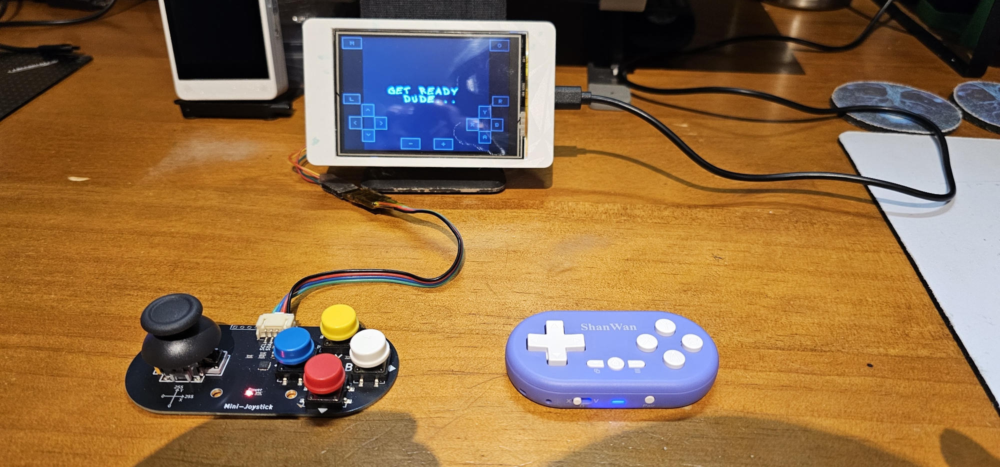
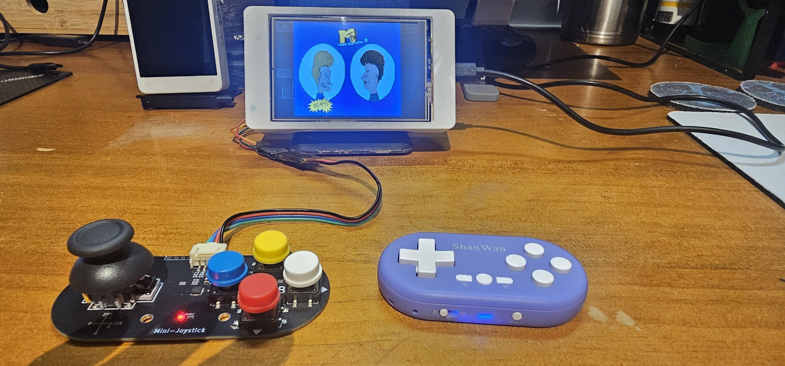
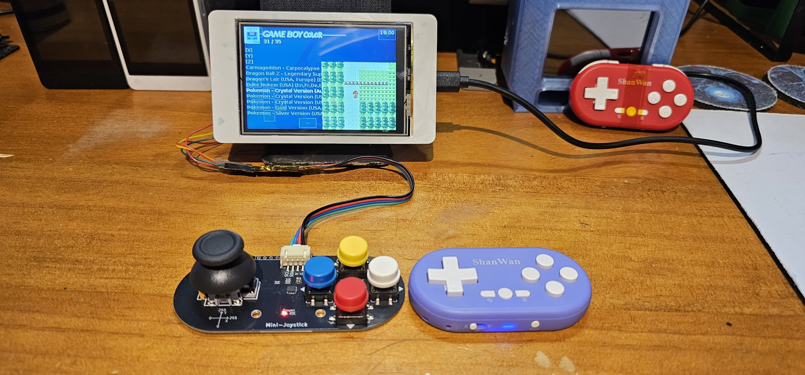

# ESP32-3248S035R

Target for the resistive-touch Sunton ESP32-3248S035R (CYD) with the ESP-PSRAM64H U4 modification documented in the user's hardware notes.

## Firmware sets (x51)

The board has **4 MB flash**, independently verified with `esptool flash_id`; its PSRAM does not increase firmware storage. The Bluetooth-enabled launcher, retro-core and Doom already exceed 4 MB together, before Mega Drive. Use separate firmware sets instead of trying to install all apps at once:

| `RG_3248_PROFILE` | Apps | Systems available |
|---|---|---|
| `core` (default) | launcher + retro-core | GB, GBC, NES/FDS, SNES, GG, SMS, PCE, Lynx |
| `md` | launcher + gwenesis | Mega Drive / Genesis (`md` ROM folder) |
| `doom` | launcher + prboom-go | Doom |

Game & Watch and ColecoVision are disabled in this target's launcher and dispatch. Other targets retain them. MSX is deliberately excluded from these sets. x51 preserves x50's emulator/audio tuning, Bluetooth, PSRAM, wired joystick and touch settings. Mega Drive's 64 KB M68K work RAM is placed in PSRAM to fit alongside Bluetooth; other targets retain their original placement. Mega Drive and Doom performance require separate hardware testing; their presence is not a full-speed compatibility claim.

The MD launcher and a user-selected game booted on the verified board, with SD mounting and PSRAM testing successfully. The user reported it "runs perfect without audio". The initial game capture exposed watchdog starvation when audio was disabled/nonblocking; this target yields for one scheduler tick every 250 ms so the idle task can run. Performance with audio enabled and broader ROM compatibility remain unverified.

### MD memory headroom (x52)

The user reported memory exhaustion when enabling audio. x51 gameplay had only 6-7 KB internal heap free despite more than 3 MB free PSRAM; the exact allocation failure was not reproduced during capture. x52 places MD's video surface, VRAM, synthesis sample buffers and LFO lookup table in PSRAM, alongside the M68K work RAM. Internal DAC DMA buffers remain internal. This placement is target-only.

x52 was app-only flashed to the verified board (MAC `68:09:47:f7:06:8c`, COM28), with both hashes verified, preserving NVS and the already-approved MD partition table. Boot confirmed x52, SD mounting, loaded touch calibration and a successful PSRAM test. Gameplay with audio held approximately 89-91 KB internal heap free (largest block 88 KB) and about 3.4 MB PSRAM free, with no allocation failures or watchdog warnings in the 35-second capture. This confirms recovered headroom, not proof that the original intermittent failure can never recur.

Audio-enabled gameplay remains CPU-limited: roughly 26-42 simulated FPS at 96-99% busy in the captured scenes, with only 11-19K samples/sec versus the approximately 26.6K target. The memory change is not an audio-speed fix. The wired joystick was not responding on I2C during this test; Bluetooth input reports were observed. x51 Core and Doom artifacts remain available; x52 is an MD-only update.

In an ESP-IDF 5.2 PowerShell environment, select one profile and use `all` so the target chooses the correct apps:

```powershell
$env:RG_3248_PROFILE = 'md' # core, md or doom
$env:PROJECT_VER = "1.46-classic-x51-$env:RG_3248_PROFILE"
python rg_tool.py --target=esp32-3248s035r build-img all
```

Each set has a `0x170000` launcher slot at `0x10000` and a `0x170000` emulator slot at `0x180000`. **Switching sets requires updating the partition table's emulator label** as well as that slot's firmware. Copying an MD binary into a partition still named `retro-core` will not make the launcher show MD. Return to the launcher before switching sets. Do not mix a set's table with another set's emulator binary.

For an existing board, preserve NVS (`0x9000`), OTA selection (`0xD000`), PHY data (`0xF000`) and SD contents: verify the device MAC and current partition layout, then write only the selected set's partition table at `0x8000`, launcher and emulator app. Obtain approval before changing the partition table. **Do not flash the complete `.img` over an existing installation**: it contains blank NVS/OTA regions and would erase pairing data. A normal app-only update within the same set does not require changing the table. The original x50 image remains a separate recovery artifact.

Settings, ROMs and saves on SD are shared across sets. Core keeps the original `favorite.txt` and `recent.txt` bookmark lists. MD and Doom use `favorite-md.txt` / `recent-md.txt` and `favorite-doom.txt` / `recent-doom.txt` in `retro-go\config` so playing an extra set does not overwrite bookmarks for temporarily absent Core apps. GB/GBC BIOS enable settings are per namespace (`retro-go\config\gb.json` and `gbc.json`, numeric `LoadBIOS: 1`); BIOS files belong in `retro-go\bios`, not `roms\bios`. MD cartridges and Doom do not use external console BIOS files.

## Photos

The board running Retro-Go, with the wired NULLLAB Mini-Joystick (I²C) and ShanWan Q36 Bluetooth controllers.







## Working baseline: x35 (GB/GBC tested)

Firmware `retro-go_1.46-classic-x35_esp32-3248s035r.img` was built with ESP-IDF 5.2.6, flashed to the modified board, and tested by the user. Confirmed so far:

- GB/GBC gameplay, including Pokemon Crystal, with Fit scaling, smooth walking and clean speaker audio; the performance result is not a claim of full speed for every game.
- ST7796 landscape display, microSD game loading, calibrated touch controls and BOOT Menu.
- PSRAM initialization and memory test: 8MB fitted, 4MB mapped and available to the allocator. Original ESP32 I2S DMA buffers remain in internal RAM.
- Q36 Classic Bluetooth X-mode input, Start/Select and menu buttons; saved-controller reconnection through three Launcher -> game -> Launcher round trips with the controller left on, without scanning or toggling Bluetooth.
- Wired Mini-Joystick on SDA GPIO21 / SCL GPIO22: stick D-pad, red A, white B, blue X as Select, yellow Y as Start, and stick-click Menu. Held inputs release correctly; the final captures and user gameplay check had no dropouts.
- Switching between emulator types was user-confirmed. Other emulator gameplay, 16-bit-system performance and broader ROM compatibility are not yet recorded as tested.

Bluetooth, wired and touch input currently combine into Player 1; separate-player multiplayer is not implemented. Networking remains compiled in but is not recorded as runtime-tested; Doom is omitted to fit 4MB flash. A radio-calibration NVS write warning (`0x1105`, not enough space) remains observed; no bonds were erased to suppress it. Other controller models and BLE modes are not verified.

The sections below retain the chronological investigation, including earlier failures and superseded configurations. This baseline summary and the x35 result describe the current verified state.

## Hardware configuration

### Master System performance investigation (x37)

Monster World III on x35 showed 43-47 simulated FPS in busy scenes, display submission waits up to 405ms per second, and audio production falling to about 23,200 samples/sec versus the 32,000 target. x37 enables target-only `RG_SMS_SKIP_BUSY_VIDEO`: skip display submission when the previous surface is still queued, reuse the unqueued surface, and keep a separate latest palette so dropped frames do not lose palette updates or modify display-owned palette memory. Other targets retain the existing submission path; explicit redraws remain synchronous through the display API. Hardware comparison is pending.

The user further clarified that the reconnect difficulty appears when the controller is powered on late, rather than consistently depending on emulator type. This is not yet a captured reconnect failure; no Bluetooth changes are included in x37.

x37 hardware comparison: both app flash hashes verified on COM10 (ESP32 MAC `68:09:47:f7:06:8c`), preserving NVS and SD settings. The 40-second Monster World III gameplay capture held 59-61 simulated FPS and approximately 31,800-32,400 audio samples/sec; display submission wait was zero apart from one 2ms sample. The user confirmed the enemy-heavy scene was smooth with clean audio. The connected Bluetooth controller supplied input throughout. The wired module was not responding on I2C during both baseline and comparison captures; these results do not revalidate wired input. Other emulator cores have not received this change or been performance-verified. Firmware: `retro-go_1.46-classic-x37_esp32-3248s035r.img`; launcher 1,483,456 bytes, retro-core 1,496,000 bytes. Image CRC, embedded apps, partition fit and busy-buffer/palette ownership model were checked.

### Display SPI at 80 MHz (x38)

x38 raises `RG_SCREEN_SPEED` from 40 MHz to `SPI_MASTER_FREQ_80M`. The ST7796 uses GPIO12-15, the ESP32's native HSPI IOMUX pins. The XPT2046 touch controller shares that bus, but its device runs at 1 MHz and is unaffected. In a 2-minute Monster World III capture at overclock 0 on COM10, calm scenes rendered nearly every frame: 1-5 of 60 skipped at 63-80% busy, compared with x37's heavy skipping. Enemy-heavy scenes held 60 simulated FPS and 31,800-32,400 audio samples/sec, but still skipped 20-32 frames at 90-95% busy, so the remaining limit there is CPU emulation load. The user confirmed the picture is clean and gameplay feels smoother. Firmware: `retro-go_1.46-classic-x38_esp32-3248s035r.img`, CRC verified. If a particular panel shows corruption, return to `SPI_MASTER_FREQ_40M`.

### Busy-display skip for remaining retro-core systems (x39)

x39 applies the same pattern to the remaining retro-core emulators through target-only `RG_NES_SKIP_BUSY_VIDEO`, `RG_PCE_SKIP_BUSY_VIDEO`, `RG_SNES_SKIP_BUSY_VIDEO` and `RG_LYNX_SKIP_BUSY_VIDEO`. Game Gear and ColecoVision already use the Master System path. Game & Watch already submitted only when the display was free.

- NES: tracks the last submitted surface and renders the next frame into the other one. A busy display drops the frame. Redraw requests are always submitted. Palettes are identical on both surfaces.
- PC Engine and Lynx: the surface swap happens only after a successful submit, so a dropped frame is re-rendered into the same unowned surface. Lynx redraws now use the last complete frame.
- SNES: single-buffered, so it only stops queuing frames while the display is busy. Its existing render-while-transfer behaviour is unchanged.

Genesis, Doom and MSX are separate apps that are not part of this image and were not changed. x39 was flashed to COM10 with both app hashes verified and booted to the launcher without errors. Per-system gameplay testing is pending. Firmware: `retro-go_1.46-classic-x39_esp32-3248s035r.img`, CRC verified; retro-core is 1,496,032 bytes, leaving 11,296 bytes spare.- ESP32-WROOM-32, 4 MB flash, original ESP32 with Classic Bluetooth and BLE radio
- ESP-PSRAM64H, 8 MB fitted at U4; ESP-IDF maps the supported 4 MB addressable region
- PSRAM is configured as 64-Mbit Quad SPI at 80 MHz, using the ESP32 defaults GPIO16 for CS and GPIO17 for clock
- The PSRAM U4 pin 1 and pin 6 are isolated from the footprint pads and wired to GPIO16 and GPIO17; pin 1 has a 10 kOhm pull-up to 3.3 V
- LED1 is removed because it conflicts with GPIO16 and GPIO17
- ST7796 display configured for 480x320 landscape: SPI2, MOSI 13, MISO 12, CLK 14, CS 15, DC 2, backlight 27
- microSD: SPI3, MOSI 23, MISO 19, CLK 18, CS 5
- Speaker amplifier input is driven from the ESP32 internal DAC on GPIO26
- GPIO0 (BOOT) is mapped to Menu; the target has no other built-in gamepad buttons

The target configuration follows the documented ESP32-3248S035R pinout and the PSRAM64H Option 2 modification from the prior hardware work. Verify the chip and wiring if the board differs from that documented modification; PSRAM is required and is not configured to silently ignore a missing chip.

## Bluetooth

The default firmware uses ESP-IDF Bluedroid and `esp_hid` Classic HID for the Q36 in **X mode**, advertised as `Xbox Wireless Controller`. With no saved controller, Retro-Go runs one approximately 31-second first-use inquiry at boot and connects the first matching gamepad. Put just one controller in X-mode pairing during this window. It does not repeat discovery indefinitely. Bluedroid prefers PSRAM for allocations. Pairing keys are stored in NVS. BLE and Bluetooth audio are not enabled in this configuration.

Open **Options > Bluetooth options** in the launcher or an emulator:

- **Bluetooth enable** disconnects and stops inquiry, reconnect attempts, and incoming connections. Off lasts until reboot; the host stack remains allocated. This prevents losing the only navigation control permanently.
- **Scan / connect** starts a bounded approximately 10-second inquiry. Use **Refresh devices** to update the list, then select a controller to connect. Scanning is allowed while connected so the current controller can navigate; selecting another controller disconnects the current one.
- **Save controller** remembers the connected controller's address and name in `/sd/retro-go/config/global.json` (`BluetoothAddress` and `BluetoothName`). The stack's pairing keys stay in NVS. Save once after initial pairing; menu settings remain on SD across firmware updates.
- **Connect saved** makes a direct connection without requiring discovery/sync mode. At boot and after a disconnect, the saved address is retried up to five times with increasing delays (5, 10, 20, 40, 60 seconds). After that it remains idle; use Connect saved to retry. The controller must be powered on and accepting connections.
- **Refresh status** updates connection status and saved name. Connection failures are logged and shown in status rather than restarting endless discovery.

The Q36's normal-power-on reconnect behavior still requires device testing; saving an address cannot force a controller that is not accepting connections to respond.

### Controller handoff between apps

Launcher and retro-core are separate firmware partitions. Starting or exiting a game calls `rg_system_switch_app`, selects the destination partition, and restarts the ESP32. A live Bluetooth connection cannot survive this reset; display refresh events are not the cause.

The x11 update saves the currently connected controller to the SD config before switching apps, even if Save controller was not selected manually. A save failure leaves the current app running and displays an error. Shutdown stops discovery/retries, requests HID disconnect, and waits up to five seconds for closure plus a short controller settling delay before reboot. The destination app loads the saved address and begins direct reconnection after approximately 1.5 seconds; subsequent failures use the existing bounded retry policy. The same handoff applies when returning to Launcher. Touch input remains available during reconnection.

This implements automatic reconnection, not an uninterrupted link. Controller-specific handoff and timing still need on-device verification for x11.

The x12 and x13 images also include these handoff changes.

The x15 hardware test confirmed orderly HID and ACL disconnect before restarting into Launcher, followed by repeated HCI Page Timeout (`0x04`) during saved-controller reconnection. Manual Bluetooth Off/On eventually restored report ID 1 input in retro-core. Automatic handoff therefore remains unreliable; successful manual reconnection is not a verified handoff fix.

The experimental reconnect path waits for the Classic HID host START event and allows a 10-second, non-discoverable incoming reconnection window for the saved controller at startup and when Bluetooth is enabled. Incoming HID from a different address is rejected during that window. If no incoming link arrives, connectability is disabled before the normal bounded outbound retries. This tests whether the Q36 needs to initiate reconnection after host-driven disconnect; that explanation and the new behavior require hardware verification.

The x16 app-only build was flashed to COM28 without erasing NVS. Initial retries still produced Page Timeouts. Discovery then found the working controller at `83:2f:03:11:48:10`, whereas failed saved-address retries used `83:2e:03:11:48:10`. Connecting the discovered address succeeded. After saving the current controller and starting a game, the user reported a connected indication but no input. The transition capture confirmed clean shutdown and x16 retro-core startup, including HID START success, but was interrupted by a serial port-access error before reconnection. Neither the address mismatch nor the incoming window fully explains or resolves the remaining no-input report.

A subsequent x16 capture showed the incoming ACL never became a HID device: the 30-second timeout attempted disconnect and the SDK reported `device not connected` / `NO_CONNECTION`. The next revision no longer marks an ACL-only connection as HID setup in progress. It gives the controller three seconds to open HID, then requests host HID setup over the existing ACL rather than disconnecting it. A successful HID OPEN event, supported report map, and actual input reports remain required; a controller LED alone is insufficient.

The x17 app-only build was flashed to COM28, but startup still produced Page Timeouts using the updated saved address. The next experiment adds a bounded 10-second discovery refresh before automatic outbound retries when no saved-controller ACL is established, matching the inquiry step in the user-confirmed working Scan/connect flow. It does not change the saved address or connect to another device by name. A same-name/different-address result is logged for explicit Scan/connect and Save controller recovery. The existing five-attempt bound remains in place; automatic handoff is not yet verified.

On x18, a full game-entry capture showed the current saved address establishing ACL, but no HID OPEN or emulator input. The application's 30-second setup timeout then requested disconnect while SDP remained pending; another attempt returned BUSY, and SDP failed around 60 seconds later. The next revision waits up to 90 seconds for the SDK's setup result. After a forced timeout with an ACL still live, it blocks new opens until ACL teardown rather than treating `CLOSE / NO_CONNECTION` as sufficient cleanup. This fixes the observed premature retry overlap; the underlying SDP failure and automatic handoff still require verification.

The user subsequently confirmed x18 eventually recovered working emulator input, but with an excessive delay. Returning from the game to Launcher then reconnected quickly with working input. This establishes an observed directional difference (slow game entry versus quick Launcher return), not reliable handoff across repeated tests. x19 was not installed during these observations.

Another x18 game-entry attempt exhausted the five automatic retries. Discovery eventually saw the exact saved address (`83:31:03:11:48:10`), but the following open still failed with HCI Page Timeout. Pausing the emulator in Options and selecting Connect saved did not restore input in the user's test. Thus neither an address mismatch nor simply pausing emulation is sufficient to explain or fix every failure. x19 is built and image-verified, but not flashed; its timeout/teardown correction does not address Page Timeout itself.

The x19 app-only image was subsequently flashed to COM28 with both app hashes verified. The user confirmed quick working input via Scan/connect in Launcher, not automatic game-entry recovery. A silent/dummy audio-output test inside the game still failed to reconnect, so active I2S alone is not sufficient to explain that failure. Firmware x19 remains experimental; automatic game handoff and the intermittent speaker buzz are unresolved.

The user later recovered in-game input on x19 by waiting, toggling Bluetooth Off/On, and selecting Connect saved, with dummy audio still selected. The game then became unresponsive; holding Menu deliberately invoked `Application terminated!` and saved `/sd/crash.log`. The captured watchdog stacks resolve to dummy audio submission inside `rg_usleep`. Dummy pacing read the timer twice around its deadline check, allowing a negative difference to become an unsigned sleep duration if the deadline passed between reads. The next revision samples the remaining signed duration once and uses a yielding task delay rounded up to milliseconds, avoiding that race and short-delay idle-task starvation. This is a separate stability correction, not a Bluetooth handoff fix.

### Menu audio transitions

This target enables `RG_AUDIO_DAC_SOFT_MUTE` for its GPIO26 internal DAC output. Menu mute/unmute keeps DMA buffers at unsigned silence (`0x8000` on the active DAC channel) rather than clearing them to zero. Muting ramps the last mono sample to silence over 180 samples; unmuting fades the next 180 samples in. The target-specific conversion also mixes both stereo source channels before selecting DAC2 and queues the final audio frame, including single-frame submissions. Other targets retain their existing I2S mute behavior. This addresses the DC step in the old mute path; audible click reduction still requires listening on the board.

During x16 testing, the user reported a faint residual buzz and later a renewed buzz that stopped when the game loaded. Its source remains unconfirmed; x16 made no audio changes.

On x20, the user reported gameplay lag becoming much worse with speaker audio enabled; hiding the touch overlay did not noticeably help. Serial statistics showed transient 40-45 FPS drops and automatic frameskip increases. The next revision gates per-report Classic input and key-change tracing behind `RG_ENABLE_DEV_MODE`, retaining lifecycle and error logs. This avoids high-volume serial output on the Bluetooth callback path; its effect on gameplay requires on-device comparison. Audio buffer placement and I2S configuration are unchanged.

The x21 app-only update was flashed to COM28. The user still needed Scan/connect for controller input and reported continued lag. A gameplay capture of Pokemon Crystal showed sustained 43-50 simulated FPS intervals, followed by 60 FPS in a less demanding interval. Removing input-report logging did not resolve the slowdown. x22 enables temporary `RG_RUNTIME_DIAGNOSTICS` telemetry once per second: audio sink, submitted samples per second, elapsed audio-submit time, display processing time, display submission wait time, and the current mapped Bluetooth key mask. These times include blocking and can overlap across cores; they are not independent CPU percentages. Hold each test button for at least two seconds to observe its key mask. Audio buffering, clock settings, and button mapping are unchanged.

x22 was flashed app-only to COM28. In the moving scene, display submission blocked for up to 357 ms per second, simulated FPS fell to 39, and audio production fell to about 20,200 stereo frames/second instead of 32,000. The user reported gameplay much smoother with Scaling Off and speaker audio still enabled. Full-screen display backpressure therefore contributes materially to this slowdown; this does not rule out other costs.

x23 enables `RG_GBC_SKIP_BUSY_VIDEO` only on this target. GB/GBC skips submitting a video frame when the display still owns the previous submission, rather than blocking emulation and audio behind it. A skipped frame reuses the unqueued surface; the buffer still owned by the display must not be overwritten. Explicit menu redraws remain synchronous. Other targets and emulator cores retain their prior behavior. Full-screen motion can still have a low rendered FPS because a 480x320 RGB565 transfer at 40 MHz takes at least 61.44 ms before command/processing overhead; this change aims to preserve emulation/audio speed, not exceed SPI bandwidth. Hardware comparison is pending. x23 also samples the complete parsed HID button mask, including currently unmapped bits, once per second to diagnose +/-.

The user clarified Full had been selected manually; Fit remains the default. Fit helped but still stuttered, and hiding the overlay did not resolve walking slowdown on x22. Battles and standing still ran at full speed. After the x23 app-only flash, walking was reported good, but speaker audio still stuttered during walking. A held Q36 + produced raw button bit 12 (`0x0800`), outside the original ten-entry map; x24 maps that bit to Start without changing existing menu bindings. Held - produced no bits in the first parsed button field, so x24 logs the descriptor once at connection and at most one 16-byte input sample per second to investigate other report fields/IDs.

x24 increases this target's internal I2S DMA ring from four to eight 180-frame blocks, about 45 ms at 32 kHz instead of 22.5 ms, at a cost of 2880 additional DMA sample bytes plus descriptor overhead. This tests tolerance to short producer stalls while walking; it is not a proven audio fix and cannot compensate for sustained emulation slower than real time. Other targets retain four blocks. DMA must remain internal on original ESP32; this is not PSRAM buffering.

After the x24 app-only flash to COM28, the user confirmed Start works and walking audio is clean. The observation applies to the tested Pokemon Crystal scene with Fit scaling and overlay off, not every game or long-term stability. Held - changes byte 15 of the 16-byte report to `01`, outside the first parsed button field; its descriptor needs decoding before assigning Select.

x24 reconnection captured the complete descriptor: - is Consumer-page AC Back (usage `0x0C:0x224`) at bit 120 of report 1, not a Button-page bit. x25 parses that field and maps it to Select only on this target via `RG_GAMEPAD_HID_BACK_KEY`. + remains button bit 12 mapped to Start. Existing Menu/Option mappings are unchanged. The mapping uses descriptor offsets, not a hard-coded byte index, and clears Select on release. The x23 video-backpressure correction and x24 eight-block audio ring remain.

The x25 app-only update was flashed to COM28 with both app hashes verified, preserving NVS bonds and SD settings. The user confirmed Select, Start, existing L/R Retro-Go menu actions, and clean walking audio all work. The tested configuration is Pokemon Crystal, Scaling Fit, overlay off, speaker audio on. Reliable automatic Bluetooth game-entry reconnection and intermittent idle speaker buzz remain separate unresolved issues. Temporary runtime diagnostics remain enabled; set `RG_RUNTIME_DIAGNOSTICS` to `0` in the target configuration to omit telemetry and raw HID samples in a later build.

During subsequent x25 reconnect testing, Refresh status did not consistently reproduce a disconnect; its GUI handler only redraws status and makes no Bluetooth request. A longer capture showed a remote-initiated ACL close (`0x13`), repeated Page Timeouts (`0x04`) despite discovery seeing the saved address, then a successful incoming HID reconnect. The test also included a device restart and manual Scan/connect/Save, so it does not isolate the cause of the close or recovery. After restarting the board and rescanning/saving the controller, the user confirmed input returned automatically on the next game entry without changing Bluetooth settings. COM28 was unavailable for that game-entry capture; this is user-confirmed input, not a serial-verified lifecycle. No reconnect code was changed after x25, and reliability across repeated app switches remains unverified.

The next game-to-Launcher transition failed with a controller-connected indication but no input. USB reconnection restarted the board, so the original stuck state was lost. The subsequent startup capture showed saved-address Page Timeouts and `ERR_SDP`, not HID input. The user uses normal Q36 power-on, not a pairing button combination.

x26 reopens a non-discoverable, saved-controller incoming listener during outbound retry backoff and after the five outbound attempts are exhausted. Previously it stayed non-connectable after the initial ten-second window, so a controller-initiated recovery outside that window could not be accepted. Outbound inquiry/open still disables the listener to avoid competing opens; incoming ACL still requires a successful HID OPEN and parsed input. This corrects that listening gap but does not claim to resolve SDK SDP stalls or controller paging failures. Gameplay, audio, and button mapping are unchanged. Repeated automatic handoff needs hardware verification.

x26 was flashed app-only to COM28 with both hashes verified. Automatic Launcher input failed: the listener reopened between retries, but four inquiries did not see the Q36 and paging returned `0x04` / `ERR_SDP`. A normal controller power cycle then produced a connected indication but no input. The follow-up capture showed SDP failing with `0xeeee` on an existing ACL, followed by SDK teardown (`handle 255`, `NO_CONNECTION`, local ACL close `0x16`). Therefore the listening-gap correction does not resolve the remaining HID setup failure. No working automatic reconnect claim is made for x26.

x27 restores the exact saved, bonded controller's cached HID metadata before enabling incoming connections or starting outgoing opens. ESP-IDF 5.2 stores this metadata on successful HID connections but comments out its automatic startup loader in `btc_hh.c`. This target reads the IDF 5.2 `bt_config.conf` NVS text chunks read-only, validates every required HID field and descriptor, and submits them using public `esp_bt_hid_host_set_info`. It does not manufacture descriptor attributes, call private BTC APIs, modify the SDK, change controller identity by name, or log pairing keys. The compatibility reader and linker callback wrapper are enabled only for this target on IDF 5.2.

The wrapper observes the asynchronous SET_INFO completion for the saved address and forwards every callback to the original esp_hidh callback unchanged, preserving SDK device ownership. Startup does not initiate connections until metadata preload succeeds; missing/invalid HID metadata logs a warning and leaves the ordinary Scan/connect path available to learn it. NVS read/preload failures log explicit errors and stop Bluetooth startup. This aims to avoid repeated SDP discovery on a previously learned controller; paging failures can still occur. Hardware verification is pending.

x27/x28 preload stopped startup because SET_INFO returned status 6 (ERR) with handle 0. SDK inspection found `bta_hh_maint_dev_act` initializes that status to ERR and never changes it to OK in its successful new Classic-device branch, despite installing the descriptor and returning a valid handle. Its already-added branch does set OK. x29 therefore makes one idempotent second public SET_INFO request only for ERR with a non-invalid handle, waits for its completion, and requires actual OK before startup proceeds. Other failures remain errors; callback statuses are not rewritten. x28 also logged radio calibration NVS write failure `0x1105` (not enough space); no NVS data was erased.

x29 hardware result: both application flashes passed hash verification. Startup logged the expected status 6/handle 0 followed by status 0/handle 0, restoration of the 334-byte descriptor, successful Classic HID connection, and live controller input. The user confirmed three Launcher -> game -> Launcher round trips with the controller left powered on and working buttons after every switch, without scanning or toggling Bluetooth. The audio/video and button fixes from x25 remain included. PSRAM initialization and its memory test passed; 4MB of the fitted 8MB remains mapped on this ESP32. Radio calibration NVS writes can still report `0x1105`; this did not prevent the confirmed reconnections, and bonds/settings were preserved rather than erased. This result applies to the tested Q36 in Classic X mode, not untested controller models.

Verified firmware: `retro-go_1.46-classic-x29_esp32-3248s035r.img` in the repository root. Its footer CRC, embedded applications, and two `0x170000` app partitions were checked. Launcher is 1,470,560 bytes and retro-core is 1,483,056 bytes. For an already initialized board with this partition layout, app-only flashing preserves NVS bonds:

```powershell
python -m esptool --chip esp32 --port COM28 --baud 460800 write_flash 0x10000 launcher\build\launcher.bin 0x180000 retro-core\build\retro-core.bin
```

Do not use the complete image for this update unless intentionally replacing the partition table and NVS contents.

x30 adds a diagnostic-only NULLLAB Mini-Joystick probe on SDA GPIO21 / SCL GPIO22, address `0x5A`. The user wired power and ground separately from CN1. The manufacturer example reads X/Y from `0x10`/`0x11` and button events A/B/C/D/OK from `0x22`/`0x23`/`0x21`/`0x24`/`0x20`. The probe reads these individually every 100ms and logs changed values; failed reads log errors and back off for five seconds. Event values are 0 press, 1 release, 2 repeat, 3 single click, 4 double click, 5 long-press start, 6 long-press hold, and 8 idle. No game keys are generated yet. This diagnostic can delay normal input if the bus fails; use it for the connection check rather than gameplay benchmarking. Hardware verification is pending.

Protocol reference: https://github.com/nulllaborg/mini-joystick-module (V1.0.0 Arduino example).

x30 hardware probe passed: the module responded at `0x5A`, both axes centred at 128 and reached 0 through 255, and all A/B/C/D/OK inputs produced press (0), release (1), click (3), and idle (8) events. B also produced double-click (4). The initial startup capture had one register-read timeout that recovered after backoff; the subsequent 60-second movement/button capture contained 275 samples and no read errors. Both application flash hashes passed. This verifies the wiring and register protocol, not playable button mapping; x30 remains diagnostic-only.

x31 replaces the probe with playable wired input: module A/B/C/D -> Retro-Go A/B/X/Y, stick-click -> Menu, and X/Y -> D-pad (low X left, low Y up). Bluetooth and touchscreen input are combined with the wired input. Start/Select remain available through Bluetooth/touch. Button press/long-hold events latch until release/click events; idle event 8 does not release a held button. Axes engage below 80 or above 176 and release at 104/152 for centre hysteresis; diagonals are supported. Register reads poll every 20ms with a 10ms transaction timeout. Failed reads or invalid button events release wired controls and retry after one second, rather than retaining stuck keys or using the default 500ms I2C timeout. Raw diagnostic logging is removed. `tools\test_mini_joystick.py` exercises the production decoder's mapping, held/released events, simultaneous buttons and axis thresholds. Hardware gameplay confirmation is pending.

x31/x32 hardware corrections: the physical face labels do not match the manufacturer library's A/B/C/D register names, and the stick's vertical axis was reversed. x33 press-register capture identified red A as `0x21`; yellow Y is `0x22`, white B `0x23`, blue X `0x24`. x34 maps these physical labels directly, keeps stick-click (`0x20`) as Menu, and uses high Y for Up / low Y for Down. x32's 100kHz bus alone did not resolve the frequent 10ms read timeouts. x33 increased the bounded wait to 50ms and completed the 60-second button-identification capture and subsequent 15-second red-button capture without read errors. x34 keeps 100kHz/50ms and removes the temporary press logs. Other targets retain the default 400kHz bus and 500ms read timeout. Final physical mapping confirmation is pending.

x34 final result: both application writes verified, I2C initialized on GPIO21/22, and startup captured no joystick read errors. The user confirmed red A / white B game actions, stick directions, stick-click Menu, correct held-input releases and no dropouts. X/Y remain mapped to their physical registers; the current game does not expose their actions. Firmware is `retro-go_1.46-classic-x34_esp32-3248s035r.img` in the repository root; launcher is 1,483,456 bytes and retro-core is 1,495,984 bytes, both within their `0x170000` partitions. Footer CRC and embedded app contents were verified. App-only COM28 flashing preserves bonds/settings, using the command above.

x35 changes only the wired face-button layout at the user's request: blue X (`0x24`) -> Select, yellow Y (`0x22`) -> Start. Red A, white B, stick directions and stick-click Menu are unchanged. Bluetooth and touchscreen mappings are unchanged. Decoder tests cover Start/Select press, hold and release using the same measured registers.

x35 hardware result: both application writes verified and startup captured no joystick errors. The user confirmed blue Select and yellow Start work in-game with A/B and stick-click Menu still working. Current firmware: `retro-go_1.46-classic-x35_esp32-3248s035r.img` in the repository root; footer CRC, embedded applications and partition fit verified.

### Overclock and Bluetooth

Experimental overclock is retained behind the build-time `RG_ENABLE_DEV_MODE` setting, which defaults to `0`. In `components/retro-go/targets/esp32-3248s035r/config.h`, set it to `1` and rebuild to expose the emulator Options > Overclock control and permit nonzero levels. Normal builds hide the entry and reject nonzero levels; level `0` can still execute the original clock-restoration path, including its audio and UART adjustments. No overclock level is automatically applied at startup or during Bluetooth connection.

Developer mode does not make overclock Bluetooth-safe. Retro-Go writes the BBPLL register directly, skewing CPU/APB-derived timing outside ESP-IDF's clock management. Its audio and UART corrections do not restore Bluetooth's timing requirements; ESP-IDF's ESP32 Bluetooth controller takes an APB-frequency lock when power management is enabled. Nonzero levels log a warning in Bluetooth-enabled original-ESP32 builds. Bluetooth Off only stops activity, not the initialized host/controller. Re-enabling this experimental path is not a verified fix for controller reconnection.

The x9 update initiates Classic HID connections only, disabling incoming connections to avoid competing incoming/outgoing opens. During recovery, serial logs showed BUSY/SDP setup failures and no input reports; the user subsequently confirmed Bluetooth input returned after x9. This does not establish whether the connection-direction change or the restart/retry resolved the failure.

The shared HID report parser maps buttons, hat switch, and X/Y axes to Retro-Go keys. This target maps button bits 1-6 to A, B, X, Y, L, and R; bits 7-8 to Menu and Option; and bits 9-10 to Select and Start. Earlier physical-button labels were assumptions: the user reports L/R actually opened the Retro-Go menus and +/- previously worked as in-game Select/Start. The user now reports Q36 Start/Select no longer working, while touchscreen controls are unaffected. x21 did not change the mapping; the current +/- reports need verification before remapping. Other targets retain the generic mapping. Controllers using proprietary protocols or nonstandard reports may not work. Monitor the serial console at 115200 baud for discovery, authentication, and report-layout logs. Per-report input tracing requires developer mode; x22 uses low-rate key-mask sampling instead. Test with only one controller in pairing mode.

The source retains a non-blocking NimBLE BLE-HID client behind `CONFIG_BT_NIMBLE_ENABLED`, but that is not the selected backend. To fit Bluetooth and the emulator cores in the original ESP32's limited IRAM, the NES, Game Boy, and SMS CPU execution loops are placed in flash for Bluetooth-enabled builds. Their emulation performance should be verified on the device.

### Current hardware-test status

The Q36 in D mode (`Q36 for Android`) completes encryption, HID discovery, report-map parsing, report-protocol selection, Exit Suspend, and notification subscription for gamepad report ID 4. However, no input notifications were observed before the link disconnected with NimBLE reason 520 (HCI connection timeout). The controller LED indicating a connection is therefore not evidence of working input. A shorter initial connection interval did not prevent the timeout and was reverted. Error recovery resumes scanning rather than leaving a blocked connection task.

V mode (`ShanWan Q36`) also established a BLE link but timed out during report-map reading. Disabling Bluetooth modem sleep did not resolve these BLE failures.

The Classic-HID X-mode build subsequently authenticated successfully, parsed its 334-byte report map (report ID 1), and remained connected through the capture. The user confirmed that D-pad and face-button input controls the Retro-Go menu on COM10. This verifies menu input, not every button mapping, reconnect scenario, or emulator. Boot logs also confirm the 8MB PSRAM chip passes its memory test with 4MB mapped.

## Touch overlay

**Options > Touch controls** is available in both launcher and emulator options. It provides independent **Touch input** and **Show overlay** toggles, White/Red/Green/Blue/Yellow colour, 10-100% opacity, an independent **Button labels** toggle, and **Calibrate touch**. These settings and calibration are saved in `/sd/retro-go/config/global.json` and shared across apps (`TouchInput`, `TouchOverlay`, `TouchColour`, `TouchOpacity`, `TouchLabels`, `TouchCalibrated`, and `TouchCal0` through `TouchCal5`). Touch input defaults On, including when upgrading an existing configuration with the overlay hidden.

The XPT2046 uses GPIO33 CS and GPIO36 IRQ, sharing SPI2 MOSI13/MISO12/CLK14 with the LCD. It is a separate 1 MHz SPI device; it does not bit-bang or reconfigure the display bus. Pin assignments are documented by [ESP3D's board reference](https://esp3d.io/esp3d-tft/version_1x/hardware/esp32/sunton-35-3248/).

Before using touch, select **Calibrate touch** with the Bluetooth controller. Tap and hold each of the three crosses, releasing between them. BOOT cancels; each point times out after 30 seconds. An affine transform handles swapped/inverted axes without assuming factory calibration. Until calibration is saved, the overlay is visible but touch does not generate keys.

The overlay supplies D-pad, A/B/X/Y, L/R, Select/Start, Menu (M), and Options (O) keys, merged with Bluetooth and BOOT input. Hiding the overlay or labels does not disable hit areas; only **Touch input** disables touch keys. The overlay can also remain visible with touch input Off. Re-enabling input requires releasing the current touch before a new press registers. Calibration remains available with either toggle Off. Controls are composited into existing display buffers, including letterbox areas, rather than allocating another framebuffer. The resistive panel is single-touch: it supports menu navigation and individual game controls, not simultaneous multi-finger D-pad/button combinations.

From x13, the touchscreen face buttons use the Xbox/X-input diamond: Y at the top, A at the bottom, X on the left, and B on the right. Labels and touch actions match; the Bluetooth controller's HID mapping is unchanged.

The `1.46-classic-x6` app-only update was flashed to COM10, preserving NVS. Boot confirmed touchscreen initialization, PSRAM, and the 480x320 viewport. Serial observation confirmed discovery stops after its bounded first-use inquiry. The user confirmed the Q36 works, calibration opens, and touch buttons work after calibration. Saved-controller power-cycle reconnect, every overlay preference across reboot, and emulator performance remain unverified.

During x9 recovery, the SD configuration loaded `TouchOverlay=false` with calibration intact. Turning **Touch overlay** back On restored both visible controls and touch input, confirmed by the user. The experimental two-second BOOT hold did not visibly restore the overlay in that test; use the menu toggle rather than relying on that recovery gesture.

## Build and flash

This target defaults **Startup app** to **Launcher**, not Last game. The x8 update migrates the existing launcher preference once; it can still be changed manually afterward. Games launched with this setting return the boot partition to the launcher during initialization, preventing a reset from repeatedly booting a game. Recovering a board already stuck in a game also requires resetting OTA boot selection; reflashing only the app binaries does not change it. The x8 recovery on COM10 cleared only the 0xD000-0xEFFF OTA-data region and updated both apps, preserving NVS bonds, SD settings, and calibration. Startup was confirmed in the launcher at the normal 240 MHz CPU clock.

From an ESP-IDF 5.2 environment, build the image from the repository root with:

```powershell
python rg_tool.py --target=esp32-3248s035r build-img launcher retro-core
```

The output is `retro-go_<version>_esp32-3248s035r.img` in the repository root. The target reserves 1.4375 MiB each for launcher and retro-core. Networking is retained; Doom is omitted by user choice because all three Classic-HID-enabled apps exceed 4MB. The verified `retro-go_1.46-classic-x1_esp32-3248s035r.img` is 3,080,448 bytes. To flash later, use:

```powershell
python rg_tool.py --target=esp32-3248s035r --port=COM10 install launcher retro-core
```

Replace `COM10` if the board's serial port changes. `install` builds and flashes the full image, including the partition table and NVS region: existing Bluetooth bonds and Wi-Fi NVS data are reset; SD-card files are unaffected. The X-mode image was flashed to COM10 with user approval. Audio, full mapping, reconnect behavior, and emulator performance still require device testing.

When updating an existing Classic X-mode installation with the same two 0x170000-byte app partitions, flash just the built applications to preserve NVS pairing keys:

```powershell
python -m esptool --chip esp32 --port COM10 --baud 460800 write_flash 0x10000 launcher\build\launcher.bin 0x180000 retro-core\build\retro-core.bin
```

Do not use the app-only command if the installed partition layout differs. The SD preference file survives either method, but erasing NVS requires Bluetooth pairing again even if a controller address is still saved on SD.

## x40/x41: Q36 button layout

- Q36 (Xbox Bluetooth layout) raw buttons: A=0, B=1, X=3, Y=4, L1=6, R1=7, Start=11; Select is Consumer AC Back.
- L2/R2 are analog triggers (Simulation Brake at bit 64, Accelerator at bit 80, 10-bit). `rg_ble.c` now parses them, and `RG_GAMEPAD_HID_LTRIGGER_KEY`/`RTRIGGER_KEY` turn a press above half travel into a key.
- Mapping: L2 = Menu, R2 = Options, L1/R1 = L/R, X/Y fixed, Start/Select unchanged.
- `RG_NES_BT_SWAP_AB 1`: in NES games only, the Bluetooth A/B are swapped (right face = A, bottom face = B). Wired and touch input are unaffected.
- Verified on hardware: the report map is parsed with `lt=64 rt=80`, and A/B/Start reach the game in Super Mario World. SMW's opening text box waits for a button press; this is normal, not a freeze.

## x42: SNES full-pad keymap

- `RG_SNES_FULL_PAD_KEYMAP 1` adds a default "Full pad" SNES keymap: Start, Select, L1/R1 and all four face buttons map straight to their SNES buttons (SNES A = right face, B = bottom, X = top, Y = left). It uses the setting key `keymap_full`, so saved indexes for the stock Type A/B/C maps don't shift.
- Verified in Super Mario World: L/R scroll, Start pauses, Select drops the reserve item.
- SNES runs at about 35–40 of 60 fps with CPU 0 at 100%, which raises non-fatal IDLE0 task-watchdog warnings. Overclock stays off to protect Bluetooth timing.

## x43/x44: SNES audio

- `main_snes.c` can take a target audio rate (`RG_SNES_AUDIO_SAMPLE_RATE`) and turn off sample interpolation (`RG_SNES_AUDIO_INTERPOLATION`).
- x43 tried 16 kHz, but the internal-DAC I2S only drained about 9.7k samples/s, so the blocking audio submit held SNES at 30 fps. Do not lower the rate on this board.
- x44 keeps 32 kHz and turns interpolation off only. In Super Mario World with the speaker on: 38-48 fps, 24-31k samples/s, CPU 0 at 62-95%.
- If switching the audio sink to Speaker resets the board, lower the volume first or use a steadier USB supply (the amplifier's start-up current can dip the supply).

## x45-x50: SNES audio on core 1

- `RG_SNES_AUDIO_TASK 1`: SNES audio mixing and submission run in a `snes_audio` task pinned to core 1. Core 0 keeps the emulator and Bluetooth. The main loop waits for the previous frame's mix before sending the next, and before opening menus.
- `RG_SNES_AUDIO_FRAME_LENGTH 1`: each emulated frame mixes at least `rate / ROMFramesPerSecond` samples, and up to 1/25 s when the frame took longer. This keeps the DAC fed when SNES runs below full speed. Long frames are mixed in 640-sample chunks to stay within the snes9x mix buffer.
- Result (Super Mario World, 32 kHz, speaker): user rated it "dang near almost playable"; about 32-43 fps.
- Rejected on hardware:
  - 16 kHz (x43, x48): `i2s_get_clk` reports 16000 Hz, but the internal DAC drains only about 9.8k samples/s, so SNES drops to about 21 fps.
  - `tx_desc_auto_clear` (x48/x49): an underrun outputs 0 V instead of mid-scale on the internal DAC. This makes loud pops and visible screen flicker.
- `i2s.c` logs the requested and actual I2S rate whenever the sample rate changes.
